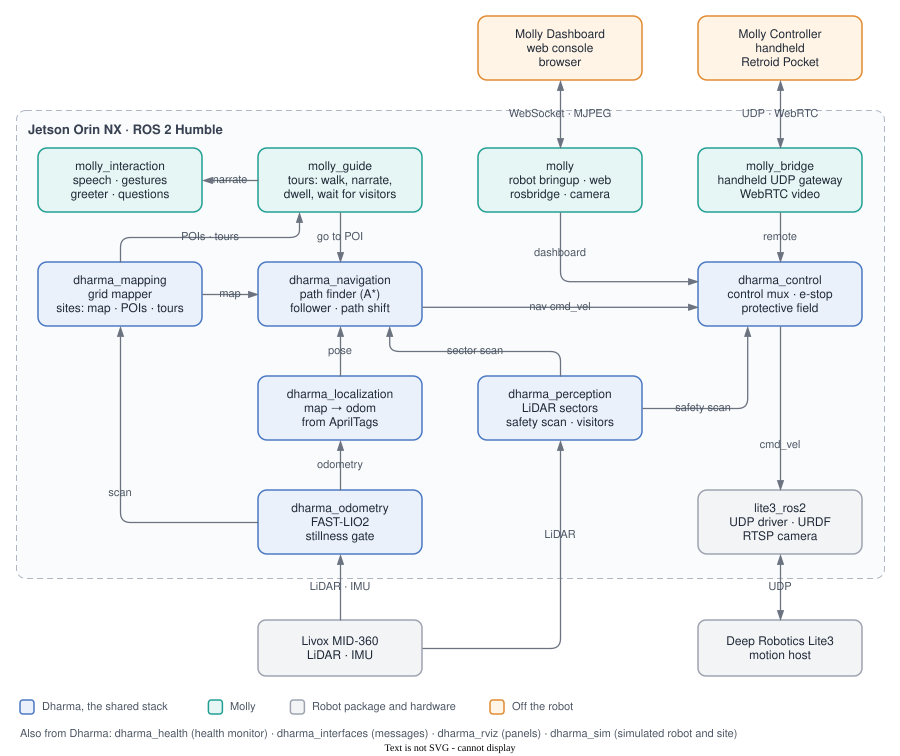

<div align="center">

# Molly

**Tour guide stack for the Deep Robotics Jueying Lite3: an occupancy map recorded together with
the AprilTags that anchor it, a path finder between points of interest, tours with narration,
and interaction with visitors — driven from a handheld and a web dashboard.**

[](https://github.com/DarmawanRobotics/Molly/actions/workflows/ci.yml)
[](https://docs.ros.org/en/humble/)
[](molly.repos)
[](https://releases.ubuntu.com/22.04/)


[](LICENSE)

[Quick start](#quick-start) · [Features](#features) · [System](#system) · [Install](#install) · [Workflow](#workflow) ·
[Operations](#operations) · [Develop](#develop) · [Docs](docs/README.md)

</div>

---

Molly walks visitors from one point of interest to the next, tells them about each one, waits
when they fall behind, and greets people who come up to it. Everything runs on the robot's Jetson
as one supervised service.

Molly runs on **Dharma**, the shared autonomy stack: LiDAR-inertial odometry, AprilTag
localization, the map and its sites, the path finder, the holonomic path follower with path shift
around people, and the protective field and e-stop in the control mux come from the `dharma_*`
repositories, at the versions pinned in [molly.repos](molly.repos). This repository adds the tours,
the interaction with visitors, the gateways for the handheld and the dashboard, and the bringup.

## Quick start

```bash
# 1. Install on the Jetson (details: Install below)
git clone --recursive https://github.com/DarmawanRobotics/Molly.git ~/dev/Molly && cd ~/dev/Molly
script/setup.sh install config && sudoedit /etc/molly/molly.env /etc/molly/site.yaml
script/setup.sh install && script/setup.sh install service && sudo systemctl start molly

# 2. Map a site: drive it in REMOTE, record the tags, save
ros2 service call /mapping/start dharma_interfaces/srv/StartMapping "{site: museum, reset: true}"
ros2 service call /localization/record_tags std_srvs/srv/Trigger
ros2 service call /mapping/save std_srvs/srv/Trigger
ros2 service call /mapping/stop std_srvs/srv/Trigger

# 3. POIs and a tour (or the dashboard's editors)
ros2 service call /site/save_poi dharma_interfaces/srv/SavePoi \
  "{poi: {name: Lobby, narration: 'Selamat datang', language: id, dwell_sec: 5.0}, at_robot_pose: true}"
ros2 service call /site/save_tour dharma_interfaces/srv/SaveTour "{tour: {name: Main, poi_ids: [lobby]}}"

# 4. Guide: localize from a tag, switch to AUTO, start the tour
ros2 service call /localization/start std_srvs/srv/Trigger
ros2 service call /bridge/set_mode dharma_interfaces/srv/SetMode "{mode: auto}"
ros2 service call /tour/control molly_interfaces/srv/TourControl "{command: {kind: 0, tour_id: main}}"

# 5. No robot: the simulator runs the same stack with a demo site
ros2 launch molly sim.launch.py rviz:=true
```

Run `ros2` commands in a shell with the service's environment (`source script/env.sh`, see
[Install](#install)). The [workflow](#workflow) explains each step.

## Features

**Map**
- Drive the robot once through the place (handheld REMOTE, or the dashboard): a 2D occupancy grid
  is built live from the LiDAR, together with the AprilTags recorded in the same session.
- Add points of interest where the robot stands, or by clicking the map on the dashboard: name,
  description, narration in Indonesian or English, a gesture and a dwell time.
- Each place is a **site** (map, tags, POIs, tours, routes) on the robot; switch sites at runtime.

**Guide**
- **Path finder**: A* on the map inflated by the robot footprint, line-of-sight shortcuts and
  smoothing, then the follower walks it and converges on the POI to 5 cm and 3°. When people
  block the way it slides around them; when nothing passes, it replans around them.
- **Tours**: POI after POI — walk, gesture, narrate, dwell — with an introduction and a goodbye,
  pause / resume / skip / stop, and an optional return point.
- **Followers**: the 360° LiDAR sees who walks behind; when nobody follows, the robot stops and
  asks the visitors to follow.
- Localization stays tag based: a tag in view localizes the robot on its map (and corrects drift).

**Interact**
- Speech with Piper voices (Indonesian and English), eSpeak NG as the fallback.
- Greets visitors who stop in front of it, with a gesture if wanted.
- Lite3 gestures: hello, nod, bow, look left / right.
- Questions typed on the dashboard answered by a local LLM (Ollama), from the site's POIs.

**Stay safe**
- Path shift around people within a bounded offset, a 360° protective field on every command,
  the latched software e-stop, navigation stops on stale odometry or LiDAR.
- The dashboard reaches only whitelisted names through rosbridge; it drives through the control
  mux like the handheld.

**Operate**
- [Molly Controller](https://github.com/DarmawanRobotics/MollyController) on a Retroid Pocket:
  drive, WebRTC video, the map with POIs, sites and mapping, tours, go-to, speech and gestures.
- [Molly Dashboard](https://github.com/DarmawanWeb/MollyDashboard) in a browser: the same, plus
  the POI and tour editors, the conversation panel and system health.
- On the robot: one systemd service with respawning nodes and health monitoring.

## System



<sub>The diagram is [docs/diagrams/system.drawio.svg](docs/diagrams/system.drawio.svg): open it in
draw.io (desktop app, [app.diagrams.net](https://app.diagrams.net) or the VS Code Draw.io
extension), edit and save, and this picture changes with it.</sub>

| Repository | |
|---|---|
| **Molly** (this) | the robot workspace: bringup, tours, interaction, handheld and dashboard gateways |
| Dharma | the shared autonomy stack, one repository per part (`dharma_mapping`, `dharma_navigation`, ...), pinned in [molly.repos](molly.repos) and checked out into `src/dharma/` |
| [lite3_ros2](https://github.com/DarmawanRobotics/lite3_ros2) | Lite3 driver (UDP motion host protocol), URDF, Mid-360 and camera launch — submodule in `src/xtras/robots/` ([contract](src/xtras/README.md)) |
| [MollyController](https://github.com/DarmawanRobotics/MollyController) | handheld app (Retroid Pocket / Android), [protocol](src/molly_bridge/PROTOCOL.md) |
| [MollyDashboard](https://github.com/DarmawanWeb/MollyDashboard) | web operator console (Next.js), [web contract](docs/web.md) |

<details>
<summary><b>Hardware</b></summary>

| Component | Model | Role |
|---|---|---|
| Robot | Deep Robotics Jueying **Lite3** (Venture) | motion host at `192.168.1.120`, UDP `43893` |
| Compute | NVIDIA **Jetson Orin NX** (JetPack 6), added | the whole stack |
| LiDAR | Livox **MID-360**, added at the LiDAR edition's mount | odometry, map, obstacles, visitors |
| Camera | the Lite3's front wide-angle camera over RTSP (or a RealSense D435i) | AprilTags, video |
| Speaker | USB or the Jetson's audio out | speech |

</details>

<details>
<summary><b>Packages</b></summary>

| Package | Role |
|---|---|
| [`dharma_odometry`](https://github.com/DarmawanRobotics/dharma_odometry) | FAST-LIO2 (or Leg-KILO), stillness gate, odometry monitor, route recording |
| [`dharma_localization`](https://github.com/DarmawanRobotics/dharma_localization) | `map → odom` from AprilTags, per-site tags, map origin for new sites, robot pose |
| [`dharma_mapping`](https://github.com/DarmawanRobotics/dharma_mapping) | occupancy grid mapper, site manager (map, tags, POIs, tours) |
| [`dharma_perception`](https://github.com/DarmawanRobotics/dharma_perception) | LiDAR sectors and 360° safety scan, visitor tracker, AprilTag camera throttle |
| [`dharma_navigation`](https://github.com/DarmawanRobotics/dharma_navigation) | path finder (A*), path follower with 6 controllers, path shift and reactive avoidance, final approach, safety; `dharma_control`: AUTO / REMOTE control mux, protective field, e-stop |
| [`dharma_health`](https://github.com/DarmawanRobotics/dharma_health) | node liveness, odometry / safety scan / e-stop state, sensor rates, CPU, GPU and RAM |
| [`dharma_rviz`](https://github.com/DarmawanRobotics/dharma_rviz) | RViz panels: Mission, Status, Tuning, AprilTags |
| [`dharma_sim`](https://github.com/DarmawanRobotics/dharma_sim) | simulated quadruped and site for the whole stack, end-to-end tests |
| [`dharma_interfaces`](https://github.com/DarmawanRobotics/dharma_interfaces) | messages and services of the stack |
| [`molly_interfaces`](src/molly_interfaces) | messages and services of the tours and the interaction |
| [`molly_guide`](src/molly_guide) | tours: walk, gesture, narrate, dwell, wait for visitors |
| [`molly_interaction`](src/molly_interaction) | speech (Piper / eSpeak NG), gestures and greeter, conversation (Ollama) |
| [`molly_bridge`](src/molly_bridge) | handheld UDP gateway with the guide commands ([protocol](src/molly_bridge/PROTOCOL.md)), WebRTC video |
| [`molly`](src/molly) | the robot: one launch with respawning nodes, site configuration, web |

The `dharma_*` packages come from their own repositories: `script/setup.sh install dharma`
(or `vcs import src < molly.repos`) checks them out into `src/dharma/` at the versions in
[molly.repos](molly.repos).

</details>

## Install

On the Jetson: Ubuntu 22.04 with ROS 2 Humble (JetPack 6), internet access, wired to the Lite3's
network, and the Jetson's SSH key added to GitHub with read access to the `dharma_*` repositories.

```bash
git clone --recursive https://github.com/DarmawanRobotics/Molly.git ~/dev/Molly
cd ~/dev/Molly
script/setup.sh install config          # creates /etc/molly/molly.env and site.yaml
sudoedit /etc/molly/molly.env           # ROBOT_BRINGUP=lite3_bringup, ROBOT_IP, SITE, ...
sudoedit /etc/molly/site.yaml           # teleop token, robot size, speeds, AprilTag ids
script/setup.sh install                 # everything missing (Dharma, SDKs, apt, speech, web), then the build
script/setup.sh install service         # systemd unit, enabled at boot
sudo systemctl start molly && journalctl -fu molly
script/setup.sh                         # every line ok?
```

**Dharma** is checked out with vcstool into `src/dharma/` (git-ignored), at the commits pinned in
[molly.repos](molly.repos). `script/setup.sh` reports a checkout that is missing or not at its
pin, and `script/setup.sh install dharma` moves it back.

**The Lite3 sends its state only to the hosts in its `network.toml`.** Add the Jetson once
(`src/xtras/robots/lite3_ros2/lite3_bringup/scripts/lite3_setup.sh network --apply`, see the
[lite3_ros2 README](https://github.com/DarmawanRobotics/lite3_ros2)), and make sure the vendor's
own navigation does not drive the robot at the same time.

**Update.** Pull, rebuild and restart:

```bash
git pull && git submodule update --init --recursive \
  && script/setup.sh install dharma build config service && sudo systemctl restart molly
```

`install dharma` follows the pins when a new Dharma release is pinned, `install build` rebuilds
whenever the checkout has moved, `install config` adds env keys that are new in the example, and
`install service` rewrites an outdated unit.

| Extra | `molly.env` | Install | Gives |
|---|---|---|---|
| Speech | `SPEECH=true` | `script/setup.sh install speech` | Piper voices (id, en), eSpeak NG, aplay |
| Dashboard | `WEB=true` | `script/setup.sh install web` | rosbridge on 9090, camera MJPEG on 8080 |
| Handheld video | `WEBRTC=true` | `script/setup.sh install webrtc` | H.264 over WebRTC through MediaMTX; JPEG without it |
| Questions | `CONVERSATION=true` | `script/setup.sh install ollama` | a local LLM (`CHAT_MODEL`, qwen2.5:3b) answers from the site's POIs |

- **`/etc/molly/molly.env`** describes the deployment: robot package, namespace, mode, site,
  extras. systemd, bash and `script/setup.sh` all read it. Quote any value with spaces, and never
  put a comment after a value.
- **`/etc/molly/site.yaml`** sets the parameters of this robot and place, on top of every package
  default ([example for the Lite3](src/molly/config/site.example.yaml)). It only needs a restart.
- **ROS stays on the robot** (`ROS_LOCALHOST_ONLY=1`); the handheld and the dashboard come in
  through their gateways only.

**A shell on the robot** needs the service's environment:

```bash
echo "alias molly='source ~/dev/Molly/script/env.sh'" >> ~/.bashrc   # once
molly
ros2 topic echo /tour/state
pnode molly_guide guide_node guide_params.yaml   # one node, as robot.launch.py runs it
```

## Workflow

**1. Map a place** (`MODE=mapping SITE=museum`, or at any time from the handheld / dashboard /
`mapping/start`):
1. Drive the robot (REMOTE) through every corridor the tours will use; the map grows on the
   handheld and the dashboard.
2. Stand still in view of each AprilTag and **Record tags**: the tags anchor the map.
3. **Add POIs** where the robot stands (handheld) or on the map (dashboard), with their narration.
4. **Save** the map, then stop mapping. Build tours from the POIs.

**2. Guide.**
- **Localize** from a tag (automatic when one is in view at start, or **Localize**).
- Switch to **AUTO** and start a tour (handheld Guide page, dashboard, or
  `ros2 service call /tour/control molly_interfaces/srv/TourControl "{command: {kind: 0, tour_id: main}}"`).
- **Go to** any POI or map point on its own with the path finder.
- Say something, greet, or play a gesture whenever the robot stands.

**Emergency stop.** The software e-stop is latched in the control mux: the handheld **STOP**,
the dashboard, or `ros2 service call /bridge/estop std_srvs/srv/SetBool "{data: true}"`. Only zero
reaches the robot while it is engaged; the tour pauses and resumes only when told. The driver's
own stop is `ros2 service call /robot/emergency_stop std_srvs/srv/Trigger`.

<details>
<summary><b>Guide behaviour</b></summary>

| Feature | What it does | Key parameters |
|---|---|---|
| Grid mapping | log-odds grid from the FAST-LIO scan, height band of obstacles, ray-cast free space | `grid_mapper_node.*` |
| Sites | map + tags + POIs + tours + routes per place, switched at runtime | `site_manager_node.sites_dir` |
| Path finder | A* on the inflated map, start / goal snapping, shortcuts, replanning when blocked | `planner_node.*` |
| Following | holonomic controller (strafes, keeps the heading along the path), final x / y / yaw approach | `path_follower_node.*` |
| Avoidance | path shift within `path_shift.max_offset`, stop short without a gap | `avoidance_mode`, `path_shift.*` |
| Tours | walk, gesture, narrate, dwell; retry or skip a POI it cannot reach | `guide_node.*` |
| Followers | pause and ask when nobody is behind for `visitor_lost_sec` | `wait_for_visitors`, `visitor_*` |
| Greeter | greet a visitor who stays in front, once per `cooldown_sec` | `interaction_node.*` |
| Protective field | v·t + v²/2a ≤ clearance − margin in every direction | `control_mux_node.field.*` |

</details>

## Operations

| | |
|---|---|
| Health | `ros2 topic echo /health/status`: `level` ok, warn or error, with sensor rates, CPU, GPU, RAM, temperature; on the handheld and the dashboard |
| Tour | `ros2 topic echo /tour/state` |
| Logs | `journalctl -fu molly`; ROS logs older than 7 days are pruned at start |
| Interfaces | every topic, service and file: [docs/interfaces.md](docs/interfaces.md) |

## Develop

**Dev container** (macOS / Linux). Check out Dharma first: `vcs import src < molly.repos`
(vcstool: `pip install vcstool`).

```bash
script/dev.sh up      # Docker: ROS 2 Humble + all deps + XFCE desktop over VNC
script/dev.sh build   # colcon build (symlink-install, Release)
script/dev.sh test
script/dev.sh vnc     # TigerVNC localhost:5901 or http://localhost:6080/vnc.html
```

**Simulation.** The whole stack runs against a simulated quadruped and site
([dharma_sim](https://github.com/DarmawanRobotics/dharma_sim)), with no robot, Gazebo or GPU:

```bash
ros2 launch molly sim.launch.py rviz:=true
ros2 service call /tour/control molly_interfaces/srv/TourControl "{command: {kind: 0, tour_id: demo}}"
```

**Tests.**

```bash
colcon test --executor sequential && colcon test-result --verbose
```

Every package runs flake8 and pep257 plus its own tests: the UDP codec and gateway, grid
mapping, the site store, A*, the tour state machine, speech and the greeter with fakes, and the
nodes in-process. End to end, the simulator runs a tour through its demo site, maps a new site,
walks back with the path finder, and slides around people on a taught route. CI runs all of it
([ci.yml](.github/workflows/ci.yml)). Branch and commit rules are in
[CONTRIBUTING.md](CONTRIBUTING.md), changes in [CHANGELOG.md](CHANGELOG.md).

```
Molly/
├── .github/workflows/            # ci.yml (build, tests, lint)
├── docker/ docker-compose.yaml   # dev container (VNC desktop, shared workspace)
├── docs/                         # interfaces, web contract, diagrams
├── map/                          # sites (map, tags, POIs, tours, routes) + example/
├── molly.repos                   # the Dharma versions (vcstool)
├── script/                       # setup.sh, run_robot.sh (service), env.sh (shell), start_tmux.sh, dev.sh
└── src/
    ├── molly molly_*             # first-party packages
    ├── dharma/                   # Dharma repositories, checked out from molly.repos (git-ignored)
    └── xtras/                    # submodules: livox_ros_driver2, FAST_LIO, robots/lite3_ros2
```

Molly is released under the [Apache License 2.0](LICENSE).
